# RushFit — Aplikasi Latihan & Progres Kebugaran

Aplikasi kebugaran pribadi untuk mencatat latihan harian, memantau progres kekuatan, dan mendapat rekomendasi latihan berbasis AI. Login hanya dengan akun Google yang terdaftar.

## Tujuan Aplikasi

Mencatat olahraga seringkali masih dilakukan manual di kertas atau spreadsheet, terpisah dari analisis progresnya. RushFit menyatukan keduanya:

- **Semua jenis latihan dalam satu tempat**: cardio (lari, bersepeda, renang), gym (beban), dan bodyweight dicatat dengan format yang sesuai tiap jenisnya.
- **Kalori otomatis**: estimasi dari MET Compendium 2024 tanpa perlu isi manual.
- **Lacak kekuatan secara ilmiah**: estimasi 1RM (formula Epley) per gerakan ditampilkan sebagai grafik, lengkap dengan proyeksi beban dari regresi linear.
- **Rekomendasi personal dari AI**: Claude menganalisis pola latihan 28 hari terakhir dan menyusun saran spesifik — termasuk kelompok otot yang jarang dilatih.
- **Privat**: login hanya dengan akun Google yang emailnya terdaftar di allowlist.

## Fitur

| Fitur | Keterangan |
|---|---|
| 🔐 **Login Google** | Auth.js + Google OAuth; hanya email di tabel `allowed_emails` yang bisa masuk |
| 🏃 **Diary Cardio** | Catat lari, jalan, bersepeda, renang — estimasi kalori dari MET Compendium 2024 |
| 🏋️ **Diary Gym** | Gerakan beban dengan set, repetisi, dan beban; estimasi kalori dari MET |
| 🤸 **Diary Bodyweight** | Gerakan tanpa beban dengan opsi tambahan beban; beban efektif dari berat badan × faktor |
| ✏️ **Edit & Hapus Sesi** | Ubah atau hapus sesi yang sudah tercatat |
| 📋 **Riwayat** | Daftar semua sesi, bisa disaring per jenis |
| 🏠 **Dashboard** | Ringkasan hari ini: sesi aktif, kalori, volume |
| ⚡ **Latihan Langsung** | Sesi real-time dengan timer, rest timer 90 detik, dan auto-save ke diary |
| 📄 **Template Latihan** | Simpan susunan gerakan favorit; gunakan langsung di sesi latihan |
| 📈 **Grafik Progres** | Estimasi 1RM (formula Epley) per gerakan dari waktu ke waktu + volume mingguan |
| 🎯 **Proyeksi Beban** | Regresi linear dari tren 1RM; tampil saat data ≥ 4 sesi |
| 💡 **Rekomendasi AI** | Claude mendeteksi ketidakseimbangan kelompok otot dan menyusun saran; bisa disimpan atau diabaikan |

## Arsitektur

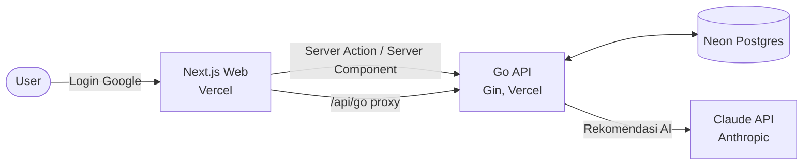

Alur singkat:

1. User login dengan Google → Auth.js memanggil Go API (`GET /v1/me`) untuk validasi email di allowlist.
2. Server Components membaca data langsung dari Go API melalui `goFetch` (server-only).
3. Client Components menggunakan route proxy `/api/go?path=...` supaya tidak langsung menghubungi Go API.
4. Sesi latihan langsung disimpan di `localStorage` selama berlangsung; saat selesai dikirim ke Go API dan masuk ke diary.
5. Go API menganalisis pola latihan dan memanggil Claude API untuk menghasilkan rekomendasi.

## Screenshot

### Beranda

Dashboard harian dengan akses cepat ke diary dan latihan langsung.

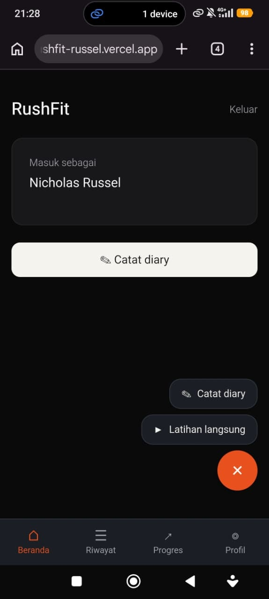

### Diary

Pilih jenis latihan (Cardio, Gym, Bodyweight), isi gerakan dan set, lalu simpan.

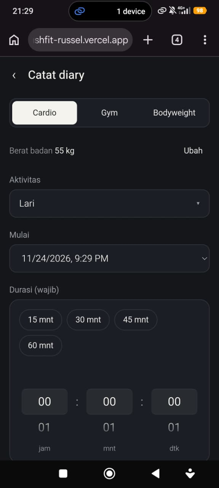 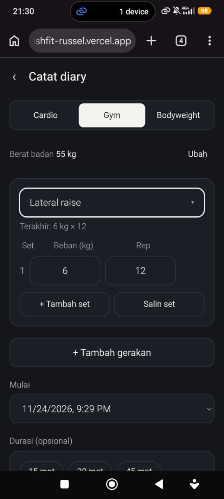 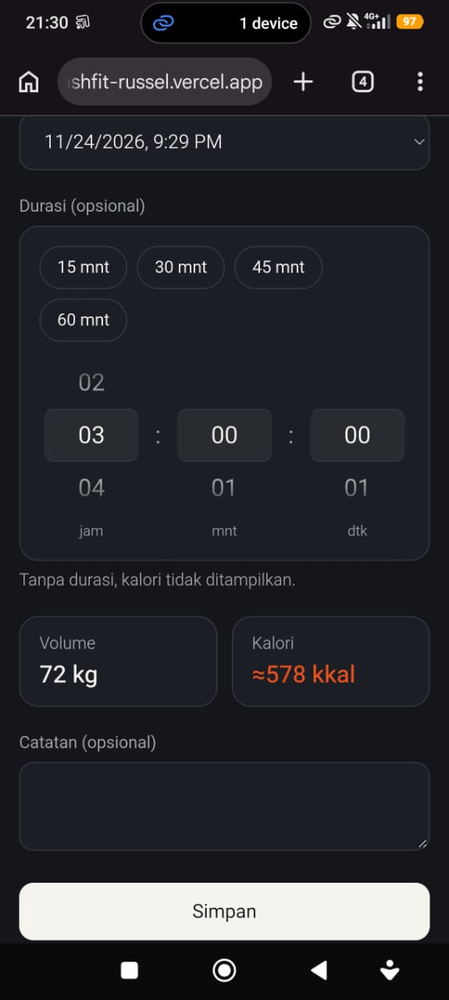

### Riwayat

Semua sesi tercatat, disaring per jenis, dikelompokkan per minggu.

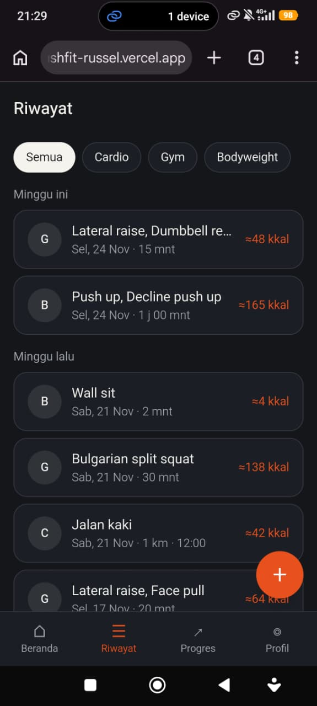 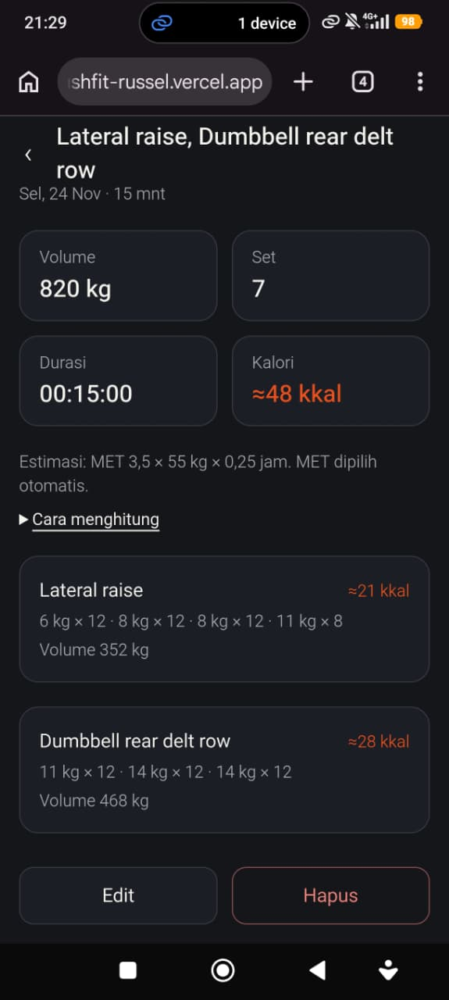

### Latihan Langsung

Mulai sesi dari nol atau dari template. Timer berjalan, rest timer muncul otomatis setelah set selesai.

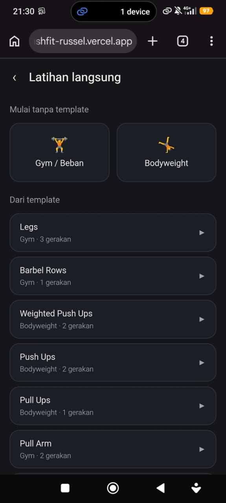 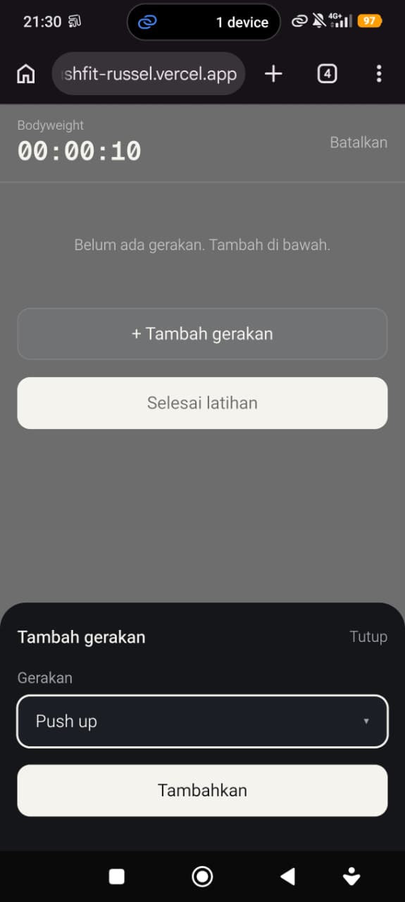 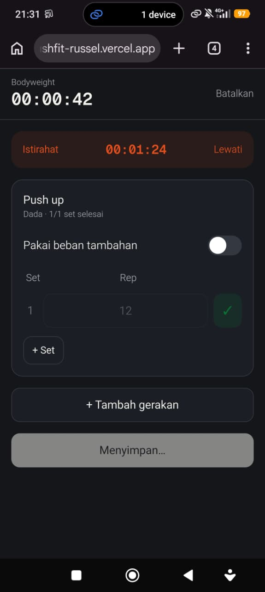

### Template

Simpan susunan gerakan favorit dan gunakan di sesi berikutnya.

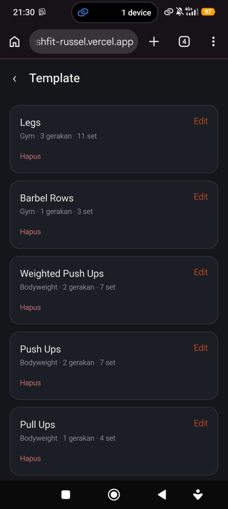

### Progres

Daftar gerakan dikelompokkan per grup otot; klik untuk melihat grafik.

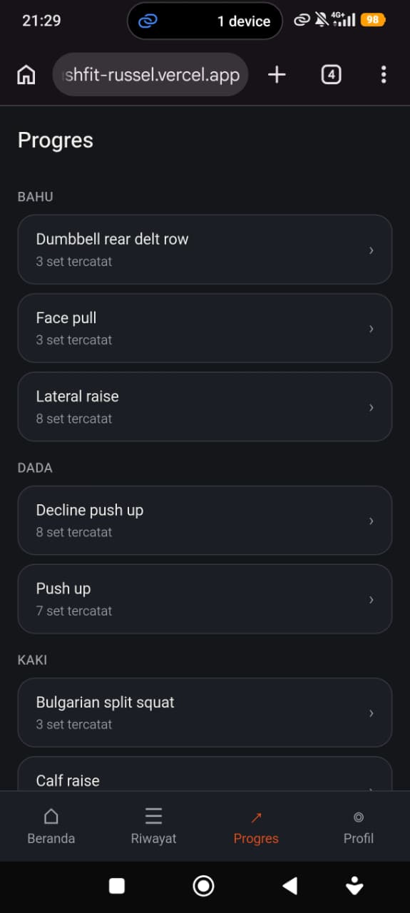 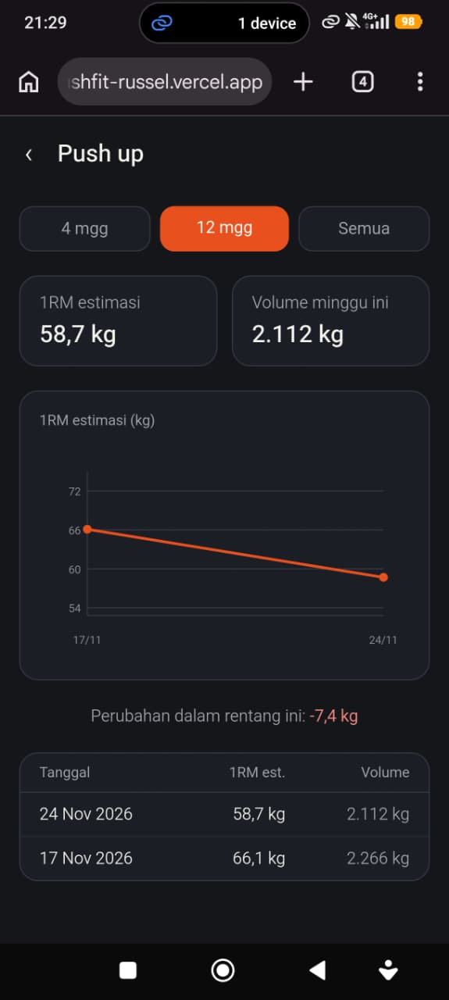

### Profil

Atur berat badan (untuk estimasi 1RM bodyweight), satuan metric/imperial, dan kelola gerakan custom.

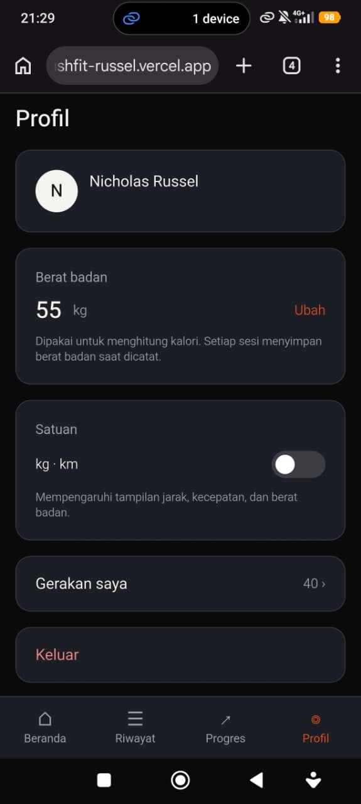

## Tech Stack

- **Frontend**: Next.js 16 (App Router), TypeScript, Tailwind CSS, Auth.js v5
- **Backend**: Go 1.25, Gin, pgx/v5
- **Database**: Neon Postgres (migrasi dengan goose)
- **AI**: Claude API (Anthropic) — rekomendasi latihan
- **Infra**: Vercel (web + API sebagai dua service terpisah)

## Struktur Folder

```
api/
  cmd/api/          # HTTP API server (Gin)
  cmd/allow/        # CLI untuk mengelola allowlist email
  internal/api/     # handler + middleware (X-Internal-Key, X-User-Email)
  internal/store/   # akses database (pgx)
  migrations/       # skema database (goose, 0001–0008)
web/
  app/              # halaman: dashboard, catat, riwayat, progres, langsung, template, profil
  components/       # UI components bersama
  lib/              # utilitas: format, session, go-api, live-session, template-types
neon.ts             # konfigurasi Neon (project RushFit, terpisah dari StocksAnalytics)
vercel.json         # konfigurasi monorepo Vercel (web + api)
```

## Menjalankan Secara Lokal

```bash
# 1. API
cd api
cp .env.example .env              # DATABASE_URL dari ../.env.local (hasil `neon link`)
go run ./cmd/api                  # http://localhost:8080

# 2. Web (terminal lain)
cd web
cp .env.example .env.local        # AUTH_*, API_BASE_URL, INTERNAL_API_KEY
npm install
npm run dev                       # http://localhost:3000
```

`INTERNAL_API_KEY` harus sama di `api/.env` dan `web/.env.local`. Tambahkan email kamu ke allowlist sebelum login:

```bash
cd api
go run ./cmd/allow -email kamu@gmail.com -role admin
```

## Database

```bash
cd api

# Migrasi (pakai koneksi direct/unpooled dari Neon)
go run github.com/pressly/goose/v3/cmd/goose@v3.24.1 \
  -dir migrations postgres "$DATABASE_URL_DIRECT" up

# Tambah/nonaktifkan email di allowlist
go run ./cmd/allow -email kamu@gmail.com -role admin
go run ./cmd/allow -email orang@gmail.com -disable
go run ./cmd/allow -list
```

Neon: project `RushFit` (`aged-cell-94215914`), region `aws-ap-southeast-1`, branch `main`.  
`npx neon env pull` memperbarui `.env.local` di root.

## Variabel Lingkungan

### `api/.env`

| Variabel | Keterangan |
|---|---|
| `DATABASE_URL` | Koneksi pooled Neon (pgBouncer) |
| `DATABASE_URL_DIRECT` | Koneksi direct Neon (untuk goose) |
| `INTERNAL_API_KEY` | Kunci rahasia antara Next.js dan Go API |
| `ANTHROPIC_API_KEY` | Kunci Claude API untuk fitur rekomendasi |
| `PORT` | Port server (default `8080`) |

### `web/.env.local`

| Variabel | Keterangan |
|---|---|
| `AUTH_GOOGLE_ID` | Google OAuth Client ID |
| `AUTH_GOOGLE_SECRET` | Google OAuth Client Secret |
| `AUTH_SECRET` | Secret untuk enkripsi sesi Auth.js |
| `API_BASE_URL` | URL Go API (otomatis diisi Vercel dari binding) |
| `INTERNAL_API_KEY` | Harus sama dengan `api/.env` |

## API Endpoints

| Method | Path | Fungsi |
|---|---|---|
| `GET` | `/v1/me` | Validasi email (dipanggil Auth.js saat login) |
| `GET/PATCH` | `/v1/profile` | Profil pengguna (berat badan, satuan) |
| `GET` | `/v1/exercises?kind=gym\|bodyweight` | Daftar gerakan |
| `POST` | `/v1/calc/workout` | Hitung kalori/volume tanpa menyimpan |
| `POST` | `/v1/workouts` | Simpan sesi latihan |
| `GET` | `/v1/workouts?kind=` | Riwayat sesi |
| `GET/PUT/DELETE` | `/v1/workouts/:id` | Detail, edit, hapus sesi |
| `GET/POST` | `/v1/templates` | Daftar dan buat template |
| `GET/PUT/DELETE` | `/v1/templates/:id` | Detail, edit, hapus template |
| `POST` | `/v1/templates/:id/start` | Tandai template terakhir dipakai |
| `GET` | `/v1/progress` | Daftar gerakan yang punya data progres |
| `GET` | `/v1/progress/:exercise_id?range=4w\|12w\|all` | Data progres + proyeksi 1RM |
| `GET` | `/v1/recommendations` | Daftar rekomendasi (auto-generate jika stale) |
| `POST` | `/v1/recommendations/refresh` | Paksa regenerasi rekomendasi |
| `PATCH` | `/v1/recommendations/:id` | Simpan atau abaikan rekomendasi |
